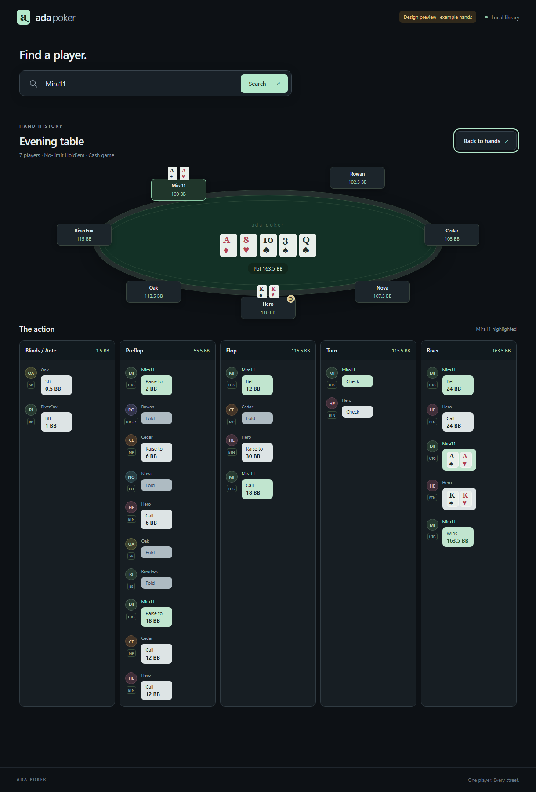
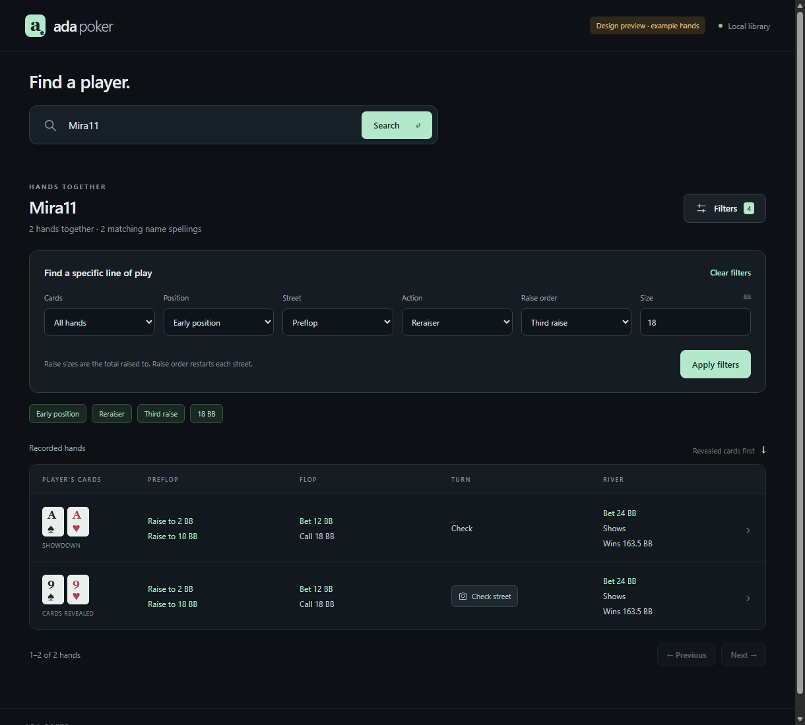
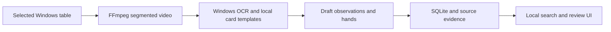

# Ada Poker

[](https://github.com/DavyStultz/Ada-Poker/actions/workflows/tests.yml)

**Turn recorded poker sessions into a searchable local review workspace.**

A Windows desktop prototype that captures a ClubGG table, reads saved footage
with local OCR and card-glyph matching, and organizes draft hands in SQLite.
The review interface makes it possible to search a player, filter their actions,
and inspect the evidence behind uncertain readings.

Python 3.12 · Windows OCR · FFmpeg · SQLite · JavaScript



*Actual application UI with fictional players and synthetic hands. This is a
demonstration of the review interface, not a claim of extraction accuracy.*

## What it does

- **Record a table:** choose a window, preview the capture, and save segmented
  video locally. Stopping saves the recording before queuing analysis.
- **Read the visible information:** extract candidate names, stacks, cards,
  actions, and hand boundaries using Windows OCR and local image templates.
- **Find a line of play:** search a username and combine street, position,
  action, raise-order, card, and big-blind amount filters.
- **Inspect uncertainty:** retain source references and uncertain readings;
  review evidence images and apply persistent name corrections.

Analysis runs after capture and stays on the computer. No cloud inference,
API key, live advice, or automated gameplay is involved.



*Synthetic search results. All amounts are shown in big blinds (BB).*

## Try the interface

Requires **Windows**, **Python 3.12** with Tkinter, and **Microsoft Edge**.
From the repository root in PowerShell:

```powershell
python -m venv .venv
.\.venv\Scripts\python.exe scripts/setup_ffmpeg.py
.\.venv\Scripts\python.exe scripts/demo.py
```

Search for **Mira11**, press Enter, and open a hand. The demo uses isolated
synthetic records, disables recording, and never imports examples into a player
database. It needs neither ClubGG nor a recording.

To open the recording and review application:

```powershell
.\.venv\Scripts\python.exe -m ada_poker
```

Actual recognition also requires the Windows English OCR language pack.
See the [usage guide](docs/usage.md) for capture, storage, and name corrections.

## How it works



The Python standard-library HTTP service binds to loopback and gives each launch
an API token. The browser UI uses plain HTML, CSS, and JavaScript. There are no
third-party Python runtime packages. Setup installs checksum-pinned FFmpeg 9.0.2
locally; the application verifies its executable before use. See [security](SECURITY.md).

Engineering choices include repeatable session imports without duplicate hands,
versioned recognition caches, capture interruption handling, and separate
observations versus inferred events. Read the [architecture notes](docs/architecture.md)
for the implementation map and tradeoffs.

## Verification and status

**Working prototype; recognition remains experimental.** The recorder, review
interface, local storage, and synthetic regression suite are implemented.
Card and name recognition is calibrated to limited table layouts. Complete
action reconstruction, bomb pots, side pots, straddles, and chip accounting still
need further work and independent footage validation. Three-hour recording
reliability has not been established.

The prepared snapshot passed **208 unit tests**, **six search browser scenarios**,
and **two combined-interface browser scenarios** locally on Windows. These checks
exercise behavior with synthetic inputs; they do not measure real-world poker
recognition accuracy. The Windows CI workflow repeats unit tests, compilation and native media security checks
on pushes and pull requests; the badge above links to the hosted results.

```powershell
.\.venv\Scripts\python.exe -m unittest discover -s tests
.\.venv\Scripts\python.exe scripts/check_search_ui.py
.\.venv\Scripts\python.exe scripts/check_combined_ui.py
```

See [testing](docs/testing.md) for coverage and the manual validation boundary.

This repository contains a curated source snapshot and synthetic examples.
Recordings, player databases, local settings, and private development notes are
not distributed. Ada Poker is an independent project and is not affiliated with
ClubGG. Third-party components retain their own licenses; no project-wide
open-source license has been granted.
